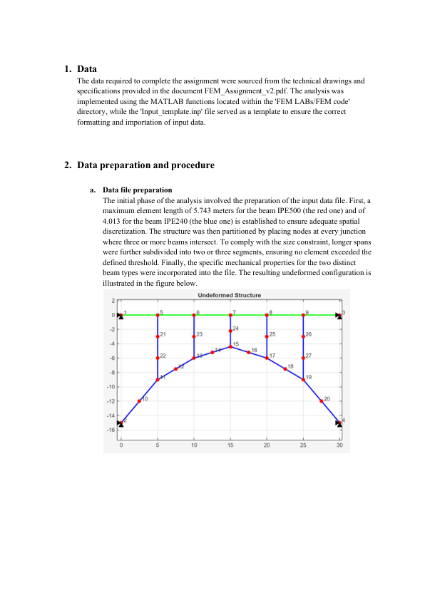

# Bridge and canopy dynamics

Two structural dynamics studies by Samuele Micotti, Lorenzo Mangili and Carlo David Furore at Politecnico di Milano.

## Bridge response under moving loads

The MATLAB study compares full and reduced beam models under concentrated, distributed and moving loads. [Read the FEM report](bridge-fem.pdf).

## Canopy modal identification

Four modes were identified from measured frequency responses. The first scaled frequency differed from the finite-element prediction by 2.4%, with a modal assurance criterion of 0.857. [Read the experimental report](canopy.pdf).

The original MATLAB assignment scripts are unavailable in this collection. A separate [truss optimization study with its MATLAB source and geometry](https://github.com/carlofurore-bit/truss-topology-optimization) is available in the portfolio.
